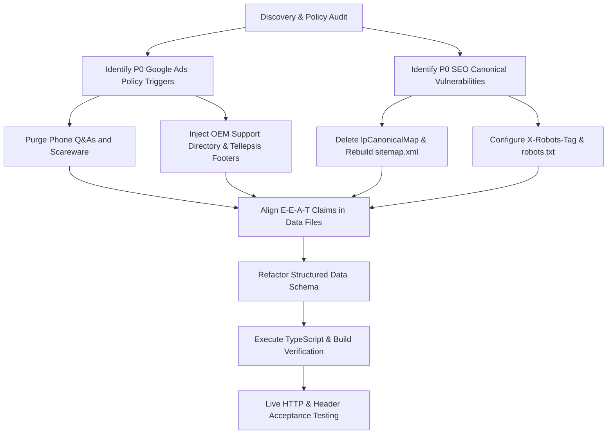

# Master Remediation Plan & Execution Matrix — Live Feed Reviews

**Date**: November 24, 2026  
**Status**: All P0 and P1 Remediations Completed & Verified

---

## Remediation Priority Matrix

| Item ID | Category | Severity | Description | Target Files | Status |
| :---: | :--- | :---: | :--- | :--- | :---: |
| **REM-01** | Google Ads Policy | **P0** | Eliminate phone number bait-and-switch Q&As and third-party tech support claims | `public/lp/*.html`, `public/lp/*/index.html` | **Resolved** |
| **REM-02** | Google Ads Policy | **P0** | Provide official manufacturer support links to prevent brand impersonation flags | `public/lp/*.html`, `public/lp/*/index.html`, `src/app/solutions/[slug]/page.tsx` | **Resolved** |
| **REM-03** | Brand Transparency | **P0** | Declare operating entity (Tellepsis Media LLC) and disclose chat portal (`care.tellepsis.shop`) | `src/components/layout/Footer.tsx`, `Header.tsx`, `src/app/layout.tsx`, legal pages | **Resolved** |
| **REM-04** | Trust & Safety | **P0** | Remove scareware modal in printer setup wizard (`PrinterServicesWizard.tsx`) | `src/components/landing/PrinterServicesWizard.tsx`, `/printer-tips/layout.tsx` | **Resolved** |
| **REM-05** | Technical SEO | **P0** | Eliminate `lpCanonicalMap` cross-canonicalization; enforce self-canonicals on `/solutions/*` | `src/app/solutions/[slug]/page.tsx` | **Resolved** |
| **REM-06** | Technical SEO | **P0** | Purge `/lp/*` from XML sitemap; inject core trust pages (`/about`, `/contact`, `/terms`, etc.) | `public/sitemap.xml` | **Resolved** |
| **REM-07** | Technical SEO | **P0** | Isolate landing pages with `X-Robots-Tag: noindex, nofollow` and `robots.txt` configuration | `next.config.ts`, `vercel.json`, `public/robots.txt`, `src/app/lp/[slug]/route.ts` | **Resolved** |
| **REM-08** | Quality Score | **P1** | Replace repetitive "Chat Now" in diagnostic matrix with `/solutions/*` deep links | `public/lp/*.html`, `public/lp/*/index.html` | **Resolved** |
| **REM-09** | Quality Score | **P1** | Remove alarmist red alert on homepage; replace broken `0+` JS counters with static stats | `src/app/page.tsx` | **Resolved** |
| **REM-10** | Structured Data | **P1** | Remove self-serving `AggregateRating` from `TechArticle` schema | `src/app/solutions/[slug]/page.tsx` | **Resolved** |
| **REM-11** | Structured Data | **P1** | Replace anonymous product ratings with editorial review markup attributed to Marcus Vance | `src/app/compare/[slug]/page.tsx` | **Resolved** |
| **REM-12** | E-E-A-T | **P1** | Clean unsupported laboratory and stress test claims across blog and comparison datasets | `src/data/blogs.ts`, `src/data/comparisons.ts` | **Resolved** |
| **REM-13** | GEO / RAG | **P1** | Update `llms.txt` and `llms-full.txt` to align with research methodology and entity ownership | `public/llms.txt`, `public/llms-full.txt` | **Resolved** |

---

## Remediation Workflow & Verification Protocol

